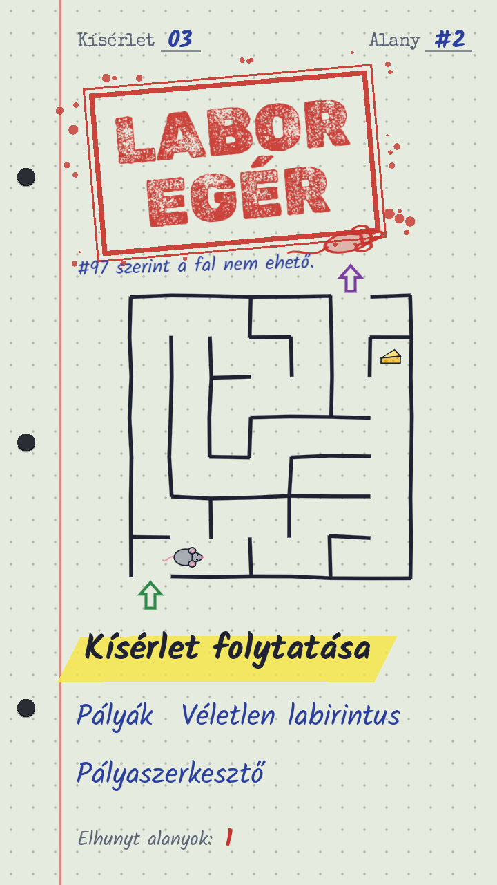
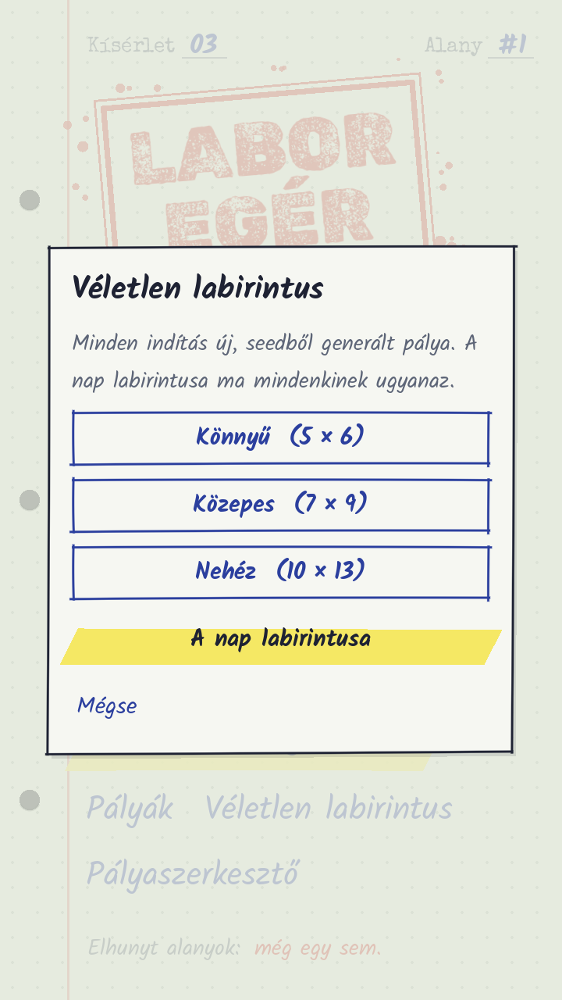
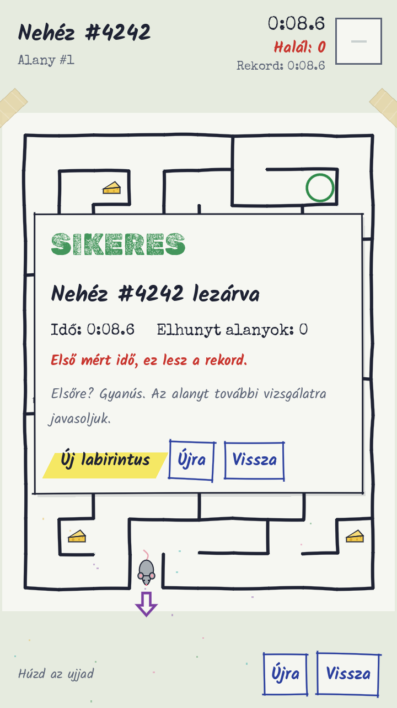
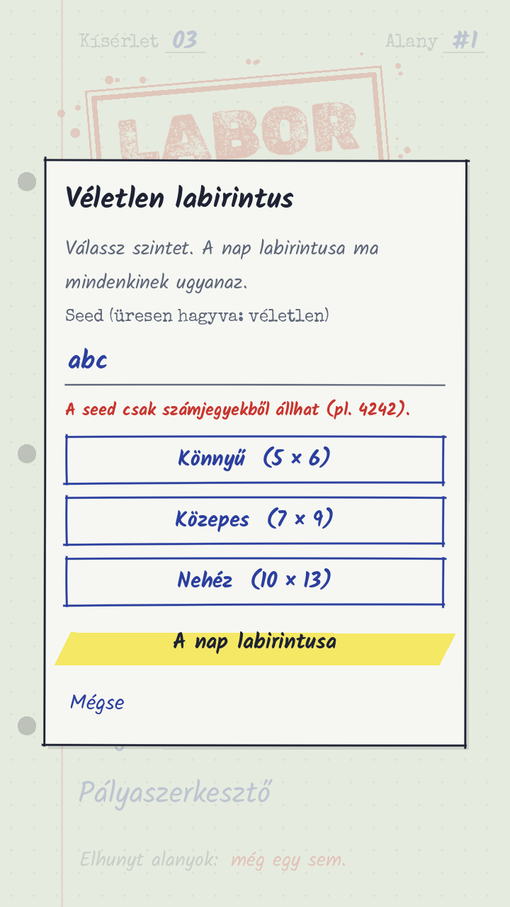

# Labor Egér

[](https://github.com/Kbence9/labor-eger/actions/workflows/tesztek.yml)

Szívatós labirintusjáték egy kísérleti egérrel, „Labornapló” stílusban (pöttyös füzet, golyóstoll, piros pecsét). Nincs jelmagyarázat:
a játékos halálokon keresztül tanul. Mobilra (Android, később iOS) és webre készül, Godot 4.7-ben.

- **Játszható webes prototípus:** `prototype/labor-eger.html` (böngészőben megnyitható)
- **Játékterv:** [docs/GDD.md](docs/GDD.md)
- **Ütemterv:** [docs/ROADMAP.md](docs/ROADMAP.md)
- **Szabályok agenteknek:** [CLAUDE.md](CLAUDE.md)

## Megnyitás

1. Indítsd a **sima** Godot 4.7-et (nem a .NET/C# verziót). Letölthető innen: <https://godotengine.org/download>.
2. Import → válaszd ki ezt a mappát (`project.godot`).
3. F5: nyitó animáció (koppintásra átugorható), utána főmenü → **Kísérlet indítása** / **Pályák** / **Véletlen labirintus** / **Pályaszerkesztő**.

Irányítás: húzd az ujjad (swipe) vagy nyilak / WASD; **R** újrakezdés, **Esc** / Android vissza gomb: vissza.

## Újdonságok (2026-11)

- **Véletlen labirintus nehézségi szintekkel:** főmenü → *Véletlen labirintus* → Könnyű (5×6) / Közepes (7×9, 2 sajt-csapda) / Nehéz (10×13, 5 csapda).
  Minden pálya seedből készül (a címben látszik, pl. „Nehéz #4242”), ugyanaz a seed ugyanazt a pályát adja. A győzelmi lapon **Új labirintus**.
- **A nap labirintusa:** a mai dátum a seed, így ma mindenkinek ugyanaz a pálya.
- **Seed kézzel (új):** a *Véletlen labirintus* ablakban beírhatsz egy seedet (pl. egy barátod „Nehéz #4242” pályájáét), aztán válassz szintet: ugyanaz a szint + seed ugyanazt a pályát adja. Üresen hagyva véletlen seed. Csak számjegy jó (1–99999999, a `#` és a szóköz nem számít); hibás bevitelnél piros üzenet jelenik meg, és az ablak nyitva marad.
- **Rekord (legjobb idő):** játék közben az időmérő alatt, a győzelmi lapon pedig „Új rekord!” vagy a különbség a rekordhoz. A véletlen labirintusnál szintenként külön rekord. Az eszközön tárolódik (`user://progress.json`; weben a böngésző tárhelyén).
- **Javítások:** hibás pálya-JSON beillesztése nem omlik össze (a hibás sorokat kihagyja és jelzi, a rossz méretűt elutasítja); sérült `progress.json` nem dönti el a játékot; győzelem után gyorsan indított új pályára nem ugrik fel a régi győzelmi lap.

| Főmenü | Véletlen labirintus | Győzelem rekorddal |
|---|---|---|
|  |  |  |



Képernyőképek: `docs/screenshots/` (a füsttesztből: `user://shots/`, Linuxon `~/.local/share/godot/app_userdata/Labor Egér/shots/`).

## Pályaszerkesztő

Főmenü → **Pályaszerkesztő** → válassz pályát, vagy **Új pálya** / **Beillesztés** (vágólapról).

**Eszközök** (alul, ikonokkal):
- **Fal:** húzd az ujjad / egeret pöttytől pöttyig, mint papíron. Ha meglévő falon kezded a húzást, azt törli. Egy szakasz közepére koppintva is váltogathatod.
- **Tégla:** ugyanígy, áttörhető falat rajzol. **Radír:** falat nyit, tárgyat töröl.
- **Folyosó:** húzd az ujjad cellán át, és kinyitja a falakat az útvonalon. A „Minden él fal” után így vájsz ki egy labirintust.
- **Tárgyak:** Start, Kijárat, Kalapács, Víz, Tűz, Repedés, Sajt, Portál A/B. Koppints a cellára; ugyanoda még egyszer koppintva leveszed. Start és Kijárat csak egy lehet; portálból párosával kettő.

**Felül:** vissza, a pálya neve, **visszavonás / újra** (Ctrl+Z / Ctrl+Y), és a **⋯ menü**:
labirintus generálása (minden nyomásra új), minden él fal / nyitott, másolat készítése, JSON másolása / beillesztése, új üres pálya, törlés.
**Szélesség / Magasság ±:** 4–12 × 4–16.

**Alul:** **Teszt** (azonnal kipróbálod, a Vissza ide hoz), **Ellenőriz** (a megoldó megmondja, megoldható-e, és zölddel megrajzolja a legrövidebb utat), **Mentés** (Ctrl+S; mentéskor is ellenőriz).
- Ha mentetlen változással lépnél ki, rákérdez.
- A Godot-szerkesztőből futtatva (F5) a repó `levels/` mappájába ment, így commitolható. Telefonon/weben az eszközre ment (`user://levels`).
- **Sorrend:** a szerkesztő pályalistájában a ▲▼ nyilakkal (`levels/order.json`).

## Tesztek

Godot 4.7 kell a PATH-on (`godot`; Windows-on a letöltött `Godot_v4.7-stable_win64.exe` is jó, ugyanezekkel a kapcsolókkal).

```
godot --headless --path . --import                   # első futtatás előtt (osztálynevek, betűk importja)
godot --headless --path . -s tests/test_core.gd     # pályák, megoldó, generátor, véletlen labirintus, hibás bemenetek
xvfb-run godot --path . --resolution 720x1280 -s tests/smoke.gd   # végigjátszás + véletlen labirintus + szerkesztő, képernyőképekkel
```

Mindkettő `FAILS=0`-t ír és 0-val lép ki, ha minden rendben. A füstteszt képei a `user://shots/` mappába kerülnek.
Ha futás közben script-hiba történik (pl. túlindexelés), a teszt **1-es kóddal azonnal kilép** és kiírja az első hibát
(`tests/error_guard.gd` figyeli), nem lóg a végtelenségig.

**CI:** a `.github/workflows/tesztek.yml` minden push és PR esetén letölti a Godot 4.7-stable-t (SHA-512 ellenőrzéssel),
importál, futtatja a `test_core.gd`-t headless, a `smoke.gd`-t xvfb alatt, és a füstteszt képernyőképeit `smoke-shots`
artifactként menti.

## Mappák

```
scenes/        Godot jelenetek (.tscn) – a UI kódból épül
tests/         headless és füsttesztek
scripts/core/  tiszta játéklogika, Node-független (pálya, lépés, megoldó, generátor, véletlen labirintus)
scripts/game/  jelenetekhez kötött kód (rajzolás, input, UI, hang)
levels/        pályák JSON-ban (formátum: docs/GDD.md) + order.json (sorrend)
assets/        betűk (licencekkel), később hangok
tools/         segédszkriptek (pl. pálya-ellenőrző)
prototype/     a webes prototípus referenciának
docs/          terv és ütemezés; docs/screenshots/ képernyőképek a README-hez
```
